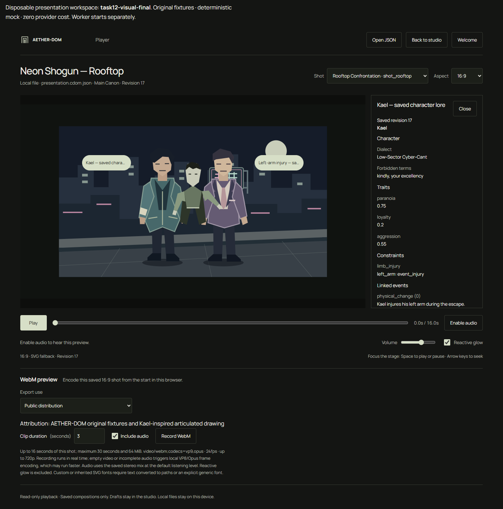
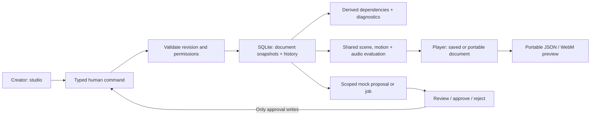

<div align="center">

# AETHER-DOM

### One creative document. A connected story, scene and sound.

**A local-first creative workspace for motion comics, animatics and episodic storytelling.**

[The idea](#the-idea) · [Features](#features) · [Try the demo](#try-the-demo) · [Architecture](#architecture) · [Roadmap](#roadmap)

**Working local prototype · Tasks 00–12 complete · AI provider is a deterministic mock**

</div>


<sub>Original Afterlight v2 concept artwork. The landing-page preview widget is illustrative; **Open studio** opens the actual application.</sub>

## The idea

A story is more than the video or image exported at the end. It has characters, events, visual layers, motion, sound and relationships that creators may want to change later. When those pieces are scattered across tools or flattened into an output, a small change can be difficult to trace and repair.

AETHER-DOM explores a different workflow: a versioned **Creative Document Object Model** (`.cdom`) connects authored story and scene data. The studio edits that saved document through validated, reversible commands; derived diagnostics and dependencies explain consequences; the player and exports use the same saved composition.

> **The current build is a working foundation, not the complete original vision.** It demonstrates editable scenes, continuity checks, reactive audio, reviewed mock proposals, branching, portable playback and lore inspection. Live generative AI, general dialogue authoring, collaboration and publishing are future work.

### Why this is interesting

- **Story context meets the scene.** Kael's explicit injured-arm constraint links to an event and can produce a traceable diagnostic when a supported action conflicts with it.
- **Changes stay inspectable.** Revisions, expected-revision checks, command history and undo/redo keep saved work distinct from temporary selections, drafts and playback.
- **One scene reaches multiple views.** Author a 16:9 scene and a separate 9:16 composition; play a saved revision, reopen a portable bundle offline, or record a WebM preview.
- **The creator retains control.** Proposals are scoped, reviewed and explicitly approved. The included provider is a predictable local mock, not a live AI model.
- **Evidence travels with the work.** Asset provenance, recorded use permissions and attribution inform export decisions; a portable bundle can carry evidence for offline inspection.

## Features

| Area | Current capabilities |
| --- | --- |
| **Local account** | First-use account creation, email/password login and logout. Server-checked sessions gate the editor and its web project API; account data stays separate from the creative document. |
| **Project and canon** | Seeded Neon Shogun project, scenes/shots, characters, events and constraints in a versioned `.cdom` model. SQLite retains saved branch snapshots, command history and undo/redo. |
| **Studio and stage** | Layer navigator, selection, drag and keyboard nudges, exact transforms, depth order, camera controls, safe static SVG import and source-element editing. Three.js/WebGL2 rendering has a native SVG fallback. |
| **Motion and rigs** | Layer keyframes interpolate on the shared clock. An original Kael-inspired rigid SVG rig supports four bones/attachments, reviewed pose changes, bone keyframes and explicit limb-action diagnostics. |
| **Continuity and dependencies** | Evidence-linked injury/recovery checks, a derived dependency graph, affected-node invalidation, and an unsaved forbidden-dialect phrase checker. Diagnostics are explainable warnings; they do not rewrite the story. |
| **Sound** | Local ambient, tension and Foley WAV fixtures; a gesture-enabled Web Audio mixer; tension-driven bindings, spatial/stereo panning and reactive glow. Saving tension is explicit; preview controls stay temporary. |
| **Proposals and jobs** | Three deterministic mock scenarios, captured scope and operation permissions, a reviewable before/after diff, approval/rejection, durable job history, an explicit worker, cancellation, bounded retry and recovery. |
| **Branches** | Fork a saved revision, switch between isolated branch histories and inspect a read-only three-way comparison against the common ancestor. There is no automatic merge. |
| **Portrait composition** | Author and review 9:16 overrides independently of landscape. **Fit subjects** proposes a draft using time-zero sprite bounds and safe guides; it is not a general layout optimizer. |
| **Lore hotspots** | Add up to eight reviewed character/event markers per shot, with authored positions for both aspects. The player displays text and evidence from the exact saved document, with keyboard operation and recoverable missing targets. |
| **Player and exports** | Play/seek saved shots with shared composition and audio behavior; export revision-bound portable JSON with supported media and evidence; reopen it while the API is unavailable; record bounded browser WebM previews. |
| **Provenance and rights** | Inspect original/current asset hashes and revision-owned evidence, review permission/attribution corrections, and evaluate private preview, public distribution or commercial-pack use before export. |
| **Presentation and recovery** | `/welcome` serves the selected Afterlight landing and leads to the real studio. A separate disposable workspace, explicit worker, source checkpoints, SQLite/media backup and fresh-tree restore support a repeatable local demo. |

The prepared fixture is intentionally small: it is an original local demonstration scene, not a generated film or an autonomous production pipeline. See [current limits](#current-limits) and the [presentation runbook](docs/presentation-runbook.md) for supported workflows.



<sub>The local player showing a saved Neon Shogun scene, lore markers and character evidence. This capture uses an isolated demonstration workspace.</sub>

## Try the demo

### Requirements

- Node.js **22.13 or newer**, pnpm **11.25.0**, and Python **3.12 or newer**.
- A modern browser. WebM recording depends on browser codec/audio support; portable JSON and the included fallback remain available.
- Internet access to install dependencies. Once installed, the seeded prototype and deterministic mock require no cloud account, API key, Docker or paid model call.

The following creates a **new, isolated** presentation workspace. Its database and media are local runtime data under ignored `data/`; they are not included in a GitHub clone. Choose another workspace name if `demo` already exists.
The commands below use Python 3.12; substitute your Python 3.12+ executable if its name differs.

### Windows · PowerShell

```powershell
# From the repository root
pnpm install --frozen-lockfile
py -3.12 -m venv .venv
.\.venv\Scripts\python.exe -m pip install -r apps/api/requirements-dev.txt

# Prepare once, then start the local presentation
node tools/presentation.mjs build
node tools/presentation.mjs setup --workspace demo
node tools/presentation.mjs start --workspace demo
```

### macOS / Linux

```bash
pnpm install --frozen-lockfile
python3.12 -m venv .venv
.venv/bin/python -m pip install -r apps/api/requirements-dev.txt

node tools/presentation.mjs build
node tools/presentation.mjs setup --workspace demo
node tools/presentation.mjs start --workspace demo
```

Open **http://127.0.0.1:3300/** to arrive at the landing page, then choose **Log in** or **Open studio**. On first use, create your local account; later visits use email/password login. The editor lives at `/studio`, and **Log out** returns to the landing page. The launcher uses the configured Python environment and a prepared production build, checks ports and readiness, and stops its own processes on Ctrl+C. It does not start the worker. The presentation API defaults to loopback port `8300`.

The account belongs to this local workspace. Password hashes and revocable12-hour sessions are stored in a separate `local-auth.sqlite3` beside its creative database; `AETHER_AUTH_PATH` can select another local account store. Source checkpoints, portable exports and creative-data backups exclude credentials. A restored workspace can create a new local account without changing its restored project. This is local browser access control; the trusted loopback FastAPI/worker/CLI interfaces remain local tools, and projects are not isolated among multiple users.

If using another Python environment, set `AETHER_PYTHON` in the process environment or root `.env.api.local`; see the [presentation runbook](docs/presentation-runbook.md). **pnpm is needed to install dependencies, but starting a prepared build and running its worker use Node directly.**

On the machine where Task 12 was prepared, `task12-presentation-final` may already exist. Start it with `node tools/presentation.mjs start --workspace task12-presentation-final`; a fresh clone must run setup for its own new workspace instead.

### Walk through the product

1. **Welcome → login → studio.** Open `/` and select **Open studio**. Create your account on first use or log in to open Neon Shogun in `/studio`; the landing interaction remains clearly labelled illustrative.
2. **Inspect a story consequence.** Open **Diagnostics** and follow Kael's injured-arm warning to its layer, constraint and event evidence. This is a supported explicit-rule check, not a claim that the app understands arbitrary scenes.
3. **Edit and recover.** Select Kael, choose **Edit transform**, change X and **Save transform**. Reload, reselect the layer and use **Undo**. The saved revision changes only when a command is accepted.
4. **Pose and animate.** Select the original Kael-inspired rig layer, choose a bone, preview an angle/action, review and save; add or inspect bone frames in **Animate**. An explicit arm `lift` can be checked against the authored injury; an angle alone makes no story claim.
5. **Hear the connection.** Open **Audio**, choose **Enable audio**, play the scene and preview tension or move the sign to hear the supported gain/pan behavior. Save tension only when you want to persist it.
6. **Review a mock proposal.** Open **Jobs**, select a scenario and **Queue mock job**. In a second terminal run the explicit worker below, then **Refresh jobs → Review result → Approve proposal**. Approval is the step that changes canon.
7. **Reframe and inspect lore.** Choose **9:16** to see the authored portrait composition. Open **Player**, select a lore marker and inspect the saved character/event details and evidence; Close or Escape returns focus to the marker.
8. **Export and reopen.** Review an intended use in **Export JSON**, download the saved bundle, and open it through **Open JSON** in the player. The bundle works without the API once the player is running. Record a WebM preview if the browser supports it.

Run the worker in a **second terminal**, using the same workspace name as the running app:

```powershell
node tools/presentation.mjs worker --workspace demo --once
```

The worker claims eligible jobs across that entire disposable workspace, not just the selected branch. `--once` attempts at most one eligible job and exits; omit it to keep the worker running. No worker starts automatically. The optional setup flag `--with-reviewed-job` prepares an already reviewed **mock fixture**; it does not connect a real provider.

### Regular development

For the regular local project, run the API and web development servers in separate
terminals:

```powershell
node tools/api.mjs dev
```

```powershell
pnpm dev
```

Open `http://127.0.0.1:3000/welcome`; the studio is at `/`, the player at
`/player`, and the seed overview at `/document`. The development API defaults
to `127.0.0.1:8000`. The regular project's database defaults to
`data/aether-dom.sqlite3` and is separate from the presentation workspace. Its
worker can be started with `node tools/api.mjs worker --once`; use the presentation
worker command above for a presentation workspace instead. See the
[API guide](apps/api/README.md) for configuration and persistence details.

## Architecture



A `.cdom` document is the canonical authored state. UI selection, draft previews, render matrices, analyser values and player navigation are temporary. A saved command validates its target and expected revision, applies the edit, updates derived dependencies and records audit/undo information. A stale or uncertain save enters a recovery state rather than silently overwriting a newer revision.

The current authored document version is **0.6.0** and the command contract is **0.9.0**. Previous supported document versions remain readable, and startup does not silently upgrade authored documents. TypeScript and Python validate shared versioned contracts. See [schema documentation](packages/schema/README.md) and [API and persistence details](apps/api/README.md).

## Rights, portability and recovery

Asset evidence records creator/source/license details, immutable media hashes, attribution, use permissions and applicable consent. Export policy evaluates **recorded assertions**; it does not establish ownership or legal clearance. Unknown, missing, stale or incompatible evidence can block the selected use. The prepared original fixture has recorded presentation evidence; it does not grant blanket commercial permission.

Portable JSON contains the saved document, supported sanitized SVG/PCM media and referenced text evidence. Review its contents before sharing. The app/player must be available to open it; only the API may be offline. WebM is a noninteractive recording and does not embed the rights ledger: retain its matching source/evidence JSON and attribution. Current WebM previews are bounded to 30 seconds, 24 fps, up to 1280×720 or 720×1280 and 64 MiB, subject to browser support.

The repository includes a [revision-17 fallback](assets/presentation/task-12/README.md): an attributed portable JSON and two **two-second** landscape/portrait WebMs from the same saved scene. Keep the files together. Hotspots remain interactive in JSON; they are not interactive in the videos.

Source checkpoints capture tracked and untracked source, binary content and verification metadata. They exclude secrets, dependency caches, Git internals and runtime data. SQLite/media backups are separate and require stopped writers; restore and checkpoint previews use new destinations. These tools assume a trusted, quiescent local filesystem. The [runbook](docs/presentation-runbook.md) contains commands and local Task 12 recovery locations.

## Current limits

- **No live AI provider or generated media:** the Director/proposal path uses deterministic local fixtures; its text prompt is not interpreted by a language model.
- **No general story/dialogue editor, speech generation or lip sync yet.** The dialect checker evaluates an unsaved draft against forbidden phrases; it does not author canon dialogue.
- **No arbitrary audio import, AI music/Foley generation, DAW or general reverb authoring.** The mixer uses the supported checked-in clips and bindings.
- **Rigid SVG rigs only:** no inverse kinematics, skin deformation, diffusion-based character generation or general raster editing.
- **No automatic branch merge, real-time collaboration, hosted accounts or public publishing.** The account and browser workflows are local to this workspace.
- **No MP4 or standalone HTML release.** WebM support varies by browser; the portable file is data for the running player.
- **No universal automatic continuity guarantee, audience telemetry or predictive attention/CTR system.** Diagnostics cover the explicit implemented rules and report evidence or limited coverage.

## Project map

```text
apps/web/                     Next.js studio, player and application routes
apps/api/                     FastAPI, commands, persistence, jobs and migrations
packages/schema/              Versioned schemas, generated types and validators
landing-page/                 Selected Afterlight v2 HTML/CSS/JS source
assets/fixtures/              Original rig, SVG and local audio fixtures
assets/presentation/          Retained portable and video fallback
tests/e2e/                    Browser workflows and acceptance checks
tools/                        API launcher, presentation and checkpoint tools
docs/                         Public presentation runbook and product images
design_archive/               Frozen prior design references
```

## Verification

From a configured development checkout:

```bash
pnpm lint
pnpm typecheck
pnpm test
pnpm build
pnpm verify:preserved
pnpm test:e2e
```

Production browser tests require a built web app, an installed Playwright browser and free loopback ports `3100` and `8100`; they use isolated test data. On a host with Microsoft Edge available, set `AETHER_E2E_CHANNEL=msedge` for that run. Run the checks below for fresh results on your machine.
