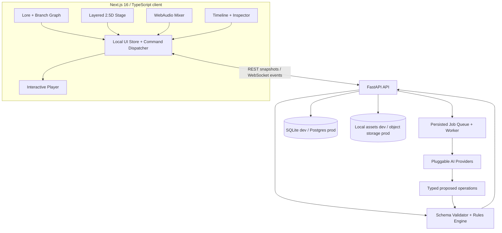

# AETHER-DOM — Master Product & Engineering Plan

**Version:** 0.1 (architecture baseline, 10 November 2026)  
**Status:** Proposed / not yet implemented  
**Source of truth:** This plan plus the versioned `.cdom` schema in `packages/schema`; upstream context was supplied in `aether_dom_plan.md` and the architecture screenshot.  
**Audience:** Founders, builders, designers, Codex coding agents, demo judges, prospective creators.

## 0. Project definition

**One sentence:** AETHER-DOM is a creative IDE for motion comics, animatics, and interactive episodic stories in which narrative canon, editable scene geometry, timeline animation, audio, and publication formats are coordinated through a versioned, typed Creative Document Object Model (`.cdom`).

**Primary problem:** Creative outputs are frequently disconnected artifacts (scripts, layered illustrations, stereo music, generated clips). A change in the story may require manual repair in every other tool. AETHER-DOM aims to preserve *semantic links* among those artifacts, so changes have inspectable, reversible effects.

**Initial user:** Solo/2–5-person motion-comic or interactive-story team. Avoid building a full general-purpose video editor or animated film studio on day one.

**Product contract:**
1. A creator owns the canonical project state and can edit it without AI.
2. Every meaningful object has a stable ID and explicit references.
3. AI returns proposed operations, not unrestricted replacement documents.
4. Dependency evaluation is deterministic, bounded, inspectable, and undoable.
5. Changes that affect canon or expensive generation require creator approval.
6. Assets remain editable when their source representation supports editing. A raster/video output is not magically converted to full vector editability.
7. Rendering and audio playback are usable offline with seeded local assets. Cloud AI is an optional enhancer, not the runtime backbone.

## 1. Scope & deliverables

### 1.1 Six integrated subsystems

| Subsystem | Responsibility | MVP? |
|---|---|---|
| **Aether Core** | `.cdom` model, command bus, validation, graph, snapshots, undo/redo, patches | Mandatory |
| **Aether Lore** | Character traits, constraints, events, branching, continuity rules, dialogue editor | Mandatory |
| **Aether Stage** | Layered SVG/sprites, transforms, parallax, 2.5D camera, basic rigs | Mandatory |
| **Aether Audio** | Sample/stem mixer, gain, tension, spatial pans, audio-reactive bindings | Phase 2 |
| **Aether Director** | Bounded AI lore/visual/audio assistant; proposal preview and approval | Phase 2 |
| **Aether Publish** | Responsive 16:9/9:16 composition, interactive player, exports, optional audience feedback | Phase 3 |

### 1.2 Supported creation workflows

**Workflow A — From premise to controllable animatic:** Create project → define world/characters → add scene and shots → edit dialogue → place editable scene layers → animate transforms → add music/Foley → preview → export interactive scene/web video.

**Workflow B — Canon change:** Change a prior event → find impacted traits, dialogue and shots → continuity linter identifies contradictions → author reviews proposals → apply structured patches → regenerate only affected derived assets.

**Workflow C — Sound/visual bridge:** Drag sound-emitting prop → panner coordinates update; change tension curve → mixer gains change; audio amplitude/bands drive a *bounded* scene property (e.g., glow intensity), without rewriting authored geometry.

**Workflow D — Branch and reflow:** Fork an alternate ending → diff relevant narrative/scene/audio nodes → preview alternative → switch output to 9:16 and reposition subjects via constraints rather than raw cropping.

**Workflow E — Publish and feedback:** Export playable `.cdom` episode or video; collect creator-approved, permissioned viewer polls; present possible future story branches without silently altering canon.

### 1.3 Explicit non-goals for the first build

No full autonomous studio, no perfect diffusion-based character consistency, no blanket “zero hallucinations”, no guaranteed 60-fps WebGPU saliency on all laptops, no true arbitrary-video editability, no guaranteed uplift in click-through rate, no unattended public posting, no immediate multi-user CRDT editing, no automatic rights clearance.

## 2. Differentiating functionality

### 2.1 Ten retained pillars from original proposal

1. **Reactive cross-modal bindings** — typed source → transform → target dependency edges.
2. **Non-destructive vector/rig composition** — editable SVG paths, controllable transforms, optional 2.5D character sprites and rig bones.
3. **Aspect-ratio scene reflow** — alternate camera/layer compositions with subject-safe constraints.
4. **Visual saliency assistance** — optional *heuristic* saliency overlay; never mislabel an unvalidated score as predicted CTR.
5. **Audience-to-canon loop** — opt-in polls/comments create draft branch proposals, not automatic canonical rewrites.
6. **Story multiverse diff/merge** — fork snapshots; compare changes; raise structured canon conflicts; preview merge.
7. **Bi-directional acoustic/visual response** — audio-reactive shaders plus coordinate-bound Foley panners.
8. **Showrunner compiler/linter** — evaluate canon, pose, assets, dialect, dependencies and missing references.
9. **Speech/viseme animation** — later phoneme alignment/TTS timings drive a small SVG mouth rig.
10. **Interactive `.cdom` player** — clickable lore props and optional choices, using same runtime schema.

### 2.2 Five additions with practical value

11. **Impact Explorer:** Click any source node to see precisely which shots, cues, and exports depend on it, and estimate rebuild cost before changing it.
12. **Change Receipts:** Every AI or user edit has author, intent, model/provider (if AI), input references, approval, timestamp and before/after diff.
13. **Constraint-aware Composition:** Keep faces/text inside safe areas, preserve character order/line of action, and enforce semantic relationships across aspect ratios.
14. **Asset Provenance & Rights Ledger:** Record whether an image/voice/music sample is creator-owned, licensed, AI-generated, or unknown; block public publishing for unknown rights by default.
15. **Playable Accessibility Layer:** Captions, speaker labels, transcripts, keyboard navigation, reduced-motion and audio-description hooks; make accessible output a first-class export option.

## 3. Reference architecture



**Critical ownership boundaries:**
- **Canonical state:** Versioned `.cdom` in the backend repository/database, with locally cached snapshots in the browser. There is exactly one canonical state per branch/revision.
- **UI state:** Zustand (selected object, panel positions, playhead, tool mode) is *not* serialized as creative canon.
- **Derived state:** renderer buffers, waveform peaks, audio-reactive values, cached thumbnails and linter results are recomputable and must never override authored data.
- **Agent output:** untrusted, version-bound, typed *proposals* validated by the server. Agents cannot directly commit or publish.
- **Collaboration:** Introduce Yjs for shared editing after single-user semantics and durable snapshots are correct; avoid two independent truths.

### 3.1 Tech choices (updated November 2026)

| Layer | Primary choice | Why / fallback |
|---|---|---|
| Web IDE | Next.js **16** App Router, React, TS, Tailwind | Next 15 was in original plan; 16 is active LTS. |
| Node canvas | `@xyflow/react` | Branches / dependencies; keep off render-critical timeline path. |
| Client state | Zustand, Immer optional | Simple local interaction; document edits via command service. |
| Validation & shared contract | JSON Schema 2020-12 + AJV (TS) + `jsonschema` (Python) | One portable schema, generated types. |
| Stage | Three.js `WebGPURenderer` + SVG editor overlay | WebGL2 fallback; start with DOM SVG and static planes, avoid duplicate Pixi + Three integration. |
| Bezier editing | Native SVG and optional Paper.js | Feature-flag advanced vector edit after selection/transform work. |
| Audio | Web Audio API + Tone.js | Deterministic mixing/panning of owned stems; no remote dependency for playback. |
| API | FastAPI, Pydantic, SQLAlchemy, Alembic | Structured and testable Python service. |
| Database | SQLite local → PostgreSQL | Canonical projects, snapshots, jobs, assets, provenance. |
| Asset storage | Local filesystem → S3-compatible bucket | Content-addressed assets, immutable originals. |
| Worker | Local persisted-job worker → Redis queue in production | Heavy tasks out of request path; retry/cancel/status. |
| Lore AI | Provider adapter, start with Gemini model configured by env | Structured operations, caching if effective; do not pin to an aging ID. |
| Visual AI | Optional remote inpaint/control adapter | *Generate separated assets*, not fake editability. |
| Music AI | Optional Lyria clip/real-time provider | Generated outputs are clips/streams, not guaranteed isolated DAW stems. |
| ASR/alignment | ASR for transcripts + separate phoneme aligner or TTS timings | Whisper word timings are not phoneme timings. |
| Exports | JSON/SVG first, browser WebM preview, backend FFmpeg for reproducible MP4 | Preserve aspect ratio settings, deterministic output pipeline. |
| Observability | Structured logs, job traces, event IDs | Reproduce cross-modal bugs and AI costs. |

### 3.2 Frontend panels

Desktop-first layout (responsive controls, but no promise of fully capable mobile editing):
- **Top:** project, branch, review status, save indicator, preview/export.
- **Left:** project explorer, cast, lore graph, branches, asset library.
- **Center:** scene viewport (stage) plus togglable dependency graph.
- **Right:** context inspector (character, layer, pose, camera, audio emitter, bindings).
- **Bottom:** shot/timeline tracks, waveforms, transport and tension envelope.
- **Diagnostics tray:** canon issues, provenance, invalid bindings, job history.
- **Review drawer:** pending AI proposals and before/after diffs.

## 4. `.cdom` data architecture

### 4.1 Format goals

Use JSON initially (later ZIP bundle or directory manifest). A `.cdom` document must be portable, validated, diffable and deterministic. Large assets are referenced via asset IDs/URIs, never embedded inline. Store **schema version**, **project/branch identity**, **revision**, **narrative**, **scenes/shots**, **layers**, **assets**, **audio**, **bindings**, and **provenance**.

**Recommended canonical node kinds:** WorldRule, Character, Event, Scene, Shot, VisualLayer, Asset, TimelineClip, AudioTrack, FoleyEmitter, Binding, InteractiveChoice, ExportPreset, TelemetrySnapshot. IDs are stable UUID/ULID-style strings (fixture IDs may be human-readable).

**Recommended typed edge kinds:** `appears_in`, `caused_by`, `renders_as`, `uses_asset`, `emits_audio`, `depends_on`, `branches_from`, `violates_rule`, `presents_choice`.

**Semantic distinction:** Character **canonical state** is derived from ordered events on the active branch; do not store contradictory effective trait values independently at several scenes. Snapshot resolved traits for performance, mark as derived. A shot references an asset and an animation rig; it does not contain the original asset bytes.

### 4.2 Command protocol

All user and agent edits use atomic commands:

```json
{
  "commandId": "cmd_001",
  "projectId": "proj_neon",
  "branchId": "main",
  "expectedRevision": 7,
  "actor": { "kind": "human", "id": "creator_1" },
  "op": "setLayerTransform",
  "targetId": "layer_kael",
  "args": { "x": -0.25, "y": 0.12, "rotationDeg": 4 },
  "reason": "Move Kael into the frame"
}
```

The server verifies branch/revision, target references, schemas and permissions; commits the change with an inverse operation; increments revision; computes impacted dependency nodes; publishes a compact `document.changed` event. **AI proposals** use the same protocol but with `actor.kind=agent`, `status=pending_review`, cost/provenance details and *no automatic commit*. The system rejects stale proposals or requests a rebase.

### 4.3 Reactive graph algorithm

1. Receive validated command → apply to copy of branch state.
2. Run schema and domain invariants. Reject invalid hard constraints; create linter diagnostics for soft canon contradictions.
3. Discover affected dependents using reverse-edge adjacency indexes.
4. Topologically order impacted compute nodes. Reject or explicitly break cycles (audio amplitude → glow is one-way; no glow → audio feedback unless damped feedback node explicitly models it).
5. Recompute only dirty derived properties; throttle high-frequency audio signals without writing every frame into the canonical document.
6. Emit one transaction with revision, changed IDs, patch, invalidations and audit receipt.
7. Allow undo/redo as inverse commands and branch rollback as revision restore.

### 4.4 Example bindings

- `char_kael.paranoia` → clamp/smooth curve → `music_tension.gain`.
- `foley_door.layerId` → world transform → `PannerNode.positionX/Y/Z`.
- `audio_analyser.lowBand` → low-pass + scalar map → `shader.neonGlow` (runtime-only).
- `beat_betrayal` → causal dependency → `scene_04.dialogue` flagged for continuity validation.

**Bi-directional** means the platform supports edit operations originating from narrative, visual, or audio domains *where a reverse rule is defined*. It does **not** mean inferring any possible story change from any visual/audio manipulation.

### 4.5 Branching

A branch is `{id, parentId, baseRevision, headRevision}` plus a copy-on-write patch/event sequence. Diff entities by ID, compare authored fields and secondary dependent changes separately. Three-way merge against the common base; unresolved changes (same character rule edited twice; conflicting layer transform; contradictory endings) become human-resolved conflicts, not silent LLM improvisation.

## 5. Narrative and linter

**Character model:** identity, goals, relationships, typed psychology traits, dialect constraints, physical state restrictions, memory refs, evidence. Use explicit canonical events and validity windows so a character's injured arm can heal later without false linter errors.

**Rule types:** `constraint.physical`, `constraint.world`, `constraint.dialect`, `constraint.timeline`, `constraint.reference`, `constraint.rights`, `constraint.layout`.

**Linter execution:**
- Immediate local rule checks on command (missing refs, conflicting transform, a known forbidden vocabulary token).
- Background server rule evaluations when event/scene graph changes.
- Optional LLM semantic judgments marked **suggestion** with cited supporting nodes, confidence and explanation.

**Example issue:** `CANON_PHYSICAL_CONFLICT` at `scene_04`, affected line: “Kael lifts the crate with his left arm”; evidence: `event_left_arm_injured` remains active. Suggested proposals: change pose to right arm OR add credible recovery event; creator chooses.

**Dialect:** The agent proposes rewrites using structured character rules. Avoid deterministic promises for authentic accents; let writers review cultural and linguistic appropriateness.

## 6. 2.5D rendering & animation

**MVP stage:** one controllable camera; background/midground/foreground planes; SVG props; imported raster character cutouts; per-layer transform `(x,y,z,rotation,scale)`; opacity, visibility; select/move/reorder; basic keyframes. A character can be a layered image/sprite with small SVG face/limb attachments before introducing full skeletal rigs.

**Advanced stage:** bone hierarchy, IK constraints, mesh deformation, localized inpainting that produces a replaceable asset/version, shader effects and parallax. All generated visual assets maintain source/provider metadata and can be swapped independently.

**Animation clock:** one authoritative timeline time in milliseconds, derived from `requestAnimationFrame` while playing and explicit `seek(t)` for export. Avoid driving animation from uncontrolled timers. For offline export render deterministic steps at target FPS.

**Bezier edit:** keep each editable SVG path as geometry plus handles; preserve path edits as project operations. Image-traced vectors need cleanup and cannot preserve all original visual semantics.

## 7. Audio engine

**MVP:** two or three creator-owned/licensed loops (ambient, bass, tension), dialogue audio and a spatial Foley clip; gain/fade/pan/reverb tied to layer transforms and tension keyframes. Always require a creator gesture to unlock browser audio context.

**Reactive bus:** audio envelope analyser values sampled at runtime update selected shader uniforms; keep audio-rate calculations out of React global rerenders. Map coordinates carefully into WebAudio listener space; provide stereo-only fallback and headphone demo mode.

**Music generation:** On-demand generated audio clip → asset with rights metadata → imported DAW track. **Never assert Lyria produces isolated stems unless the requested provider mode explicitly does so.** For true dynamic music, layer separate creator-supplied stems or sequenced synth patterns; optionally prototype Lyria RealTime separately and buffer streaming responses.

**Lip sync:** build a fixed small set of mouth shapes. For imported speech use ASR for transcript/word segments, then a separate phoneme forced-aligner or TTS phoneme timings. Fallback to approximate mouth-open envelope. Do not claim Whisper alone gives millisecond phonemes.

## 8. Tension, continuity and export mathematics

**Scene tension `T(t)`** is a *derived, normalized editorial signal*, not an objective psychological fact:

`T(t) = clamp(w_story*S(t) + w_delta*D(t) + w_motion*M(t) + w_audio*A(t), 0, 1)`

All inputs normalized to `[0,1]`, weights non-negative and sum to 1. If an AI proposes `S(t)`, retain source and confidence; creator may override tension keyframes. Smooth with an attack/release filter to avoid abrupt audio gain jumps.

**Responsive composition:** solve subject positions within target frame using constraints: safe margins, face and text visibility, non-overlap, reading order, anchoring to background, minimum scale. Start with authored `layoutOverrides['9:16']`; add a layout optimizer only once this path works. Never merely multiply X coordinates and declare the background uncropped. Editors may override automatically proposed layout.

**Saliency overlay:** start with simple contrast / centrality heuristic, later test a cited saliency predictor. It can suggest attention distribution, **not** predict or improve CTR by a claimed percentage without real A/B data.

**Export levels:**
1. `.cdom` JSON + asset manifest and validated portable bundle.
2. Scene/shot SVG/PNG snapshots and published interactive web player.
3. WebM short preview from browser; label browser/codec constraints.
4. Reproducible MP4 with server-rendered frame sequence and mixed audio via FFmpeg.
5. Branch-aware reels, captions, accessibility tracks and telemetry opt-in.

## 9. AI / agent architecture

**A shared orchestrator** receives an explicit task and returns a structured plan with low-risk operations, expensive generation jobs and review requirements. It routes to four role-specific workers, but only one bounded task may run per selected command without creator approval:

| Agent | Input | Output | Restrictions |
|---|---|---|---|
| Lore & Dialect | Selected canon nodes, scene, request | scene/line proposals, citations to canon IDs, lint suggestions | Cannot silently mutate canon |
| Visual & Rig | Selected shot/layer, style spec, references | new asset versions, vector/rig metadata, transform proposals | Never changes unrelated layers |
| Acoustic & Foley | Cue, target coordinates, tension envelope | clip asset proposal, mixer settings, cue events | No uncontrolled audio playback/public release |
| Director & Publish | Full validated snapshot, permitted distribution task | suggested cuts, 9:16 layout, caption/thumbnail/poll drafts | Publishing/social actions require explicit confirmation |

**Proposal format:** `proposalId`, `baseRevision`, `agentRole`, `scopeIds`, `operations[]`, `evidenceNodeIds[]`, `explanation`, `previewRef`, `estimatedCost`, `modelVersion`, `status`.

**Guardrail:** parse and validate the response against shared JSON Schema; enforce maximum operations and allowed target scope; sanitize any generated SVG or uploaded markup; execute domain rules; show visual diff and estimated spend; commit only after approval. Extracted text and imported lore are untrusted prompts, not system instructions.

**Providers:** `TextModel`, `ImageGeneration`, `AudioGeneration`, `SpeechAlignment`, `SaliencyAnalysis`. Keep provider classes behind interfaces and configuration flags. Local mock providers must be part of the repo for offline demo and regression tests.

## 10. APIs & data lifecycle

### 10.1 Representative REST endpoints

- `POST /api/v1/projects` — create seeded or blank project.
- `GET /api/v1/projects/{id}` — metadata.
- `GET /api/v1/projects/{id}/branches/{branch}/document` — validated snapshot + revision.
- `POST /api/v1/projects/{id}/branches/{branch}/commands` — validated optimistic-concurrency command.
- `GET /api/v1/projects/{id}/branches/{branch}/diagnostics` — linter output.
- `POST /api/v1/projects/{id}/branches` — fork.
- `GET /api/v1/projects/{id}/diff?left=...&right=...` — structural diff.
- `POST /api/v1/projects/{id}/agent-proposals` — request draft operations.
- `POST /api/v1/proposals/{id}/approve` — apply after revalidation.
- `POST /api/v1/projects/{id}/exports` — queue export job.
- `GET /api/v1/jobs/{id}` — status/result.
- `POST /api/v1/assets` — authenticated upload with type/size/rights metadata.

**WebSocket:** `/api/v1/projects/{id}/events`; topics `document.changed`, `lint.updated`, `proposal.created`, `job.updated`, `presence.changed` (last only when collaboration exists). Include `sequence` and `revision` so client can detect gaps and refetch.

### 10.2 Persistence

`users`, `projects`, `branches`, `revisions`, `commands`, `assets`, `agent_proposals`, `jobs`, `exports`, `feedback_polls`, `audit_events`. SQLite local, PostgreSQL production. Assets stored outside DB with immutable versions and SHA-256; relational metadata records rights and references. Search/vector graph can be derived later; **Qdrant and Neo4j are not needed to prove the MVP**.

**Revision snapshots:** immutable snapshot every N operations plus ordered commands/inverses; nightly backups in production. Apply migrations to `.cdom` schema versions and retain a lossless original copy.

## 11. Working with Codex: staged implementation

**Never ask Codex to build the entire platform in one prompt.** Use small feature slices with executable acceptance tests and require a summary of edited files and validation results.

| Phase | Output | Exit criteria |
|---|---|---|
| **0 — Contracts** | Monorepo, `.cdom` schema/sample, validation, docs, CI | `sample.cdom.json` validates in JS & Python; tests pass |
| **1 — First visible product** | IDE shell, scene view, inspector, graph, seeded project | Can select/edit layer, save/reload, undo/redo |
| **2 — Reactive core** | Commands, dependencies, linter, diagnostics, impacted-node inspector | Editing character trait changes dependent preview; contradictory pose warns with evidence |
| **3 — Live multimodal** | Timeline, stems, panner, tension bindings, audio-reactive property | Moving prop pans audio; tension smoothly crossfades layers |
| **4 — AI director** | Provider adapter, mock, scoped lore proposals, review diff | AI has zero unauthorized direct DB mutations; can approve/reject/rebase |
| **5 — Publish** | 9:16 constraints, player, bundle + WebM export | Same shot renders both aspect ratios with visible characters |
| **6 — Product depth** | Branch diff, merges, collab, advanced rigs, remote generation, audience feedback | Separate integration tests and cost gates per module |

**Suggested implementation order for a demo deadline:** 0 → 1 → 2 → 3 → 5; insert minimal AI lore proposals at the end if time. A reliable deterministic core beats four unreliable AI agents.

### 11.1 Suggested repository

```text
aether-dom/
  AGENTS.md                       # Agent instructions for Codex
  README.md
  .env.example
  pnpm-workspace.yaml
  apps/
    web/                          # Next.js studio and player
      src/app/
      src/components/studio/
      src/components/lore/
      src/components/stage/
      src/components/audio/
      src/features/commands/
      src/features/timeline/
      src/lib/api/
    api/                          # FastAPI
      app/main.py
      app/api/v1/
      app/domain/commands/
      app/domain/linter/
      app/domain/dependency_graph/
      app/services/agents/
      app/services/exports/
      app/persistence/
      tests/
  packages/
    schema/                       # .cdom canonical contract and fixtures
    engine/                       # pure TS graph/transform/evaluate helpers
    player/                       # independent scene player
    ui/                           # shared studio UI pieces
  assets/fixtures/neon-shogun/
  docs/adr/
  docs/tasks/
  scripts/
```

### 11.2 Minimum local run

Windows + Node/pnpm + Python with no mandatory Docker/cloud dependency: `pnpm install`, start frontend `pnpm --filter web dev`, backend in `apps/api` via `uv run uvicorn app.main:app --reload` (once scripts/pyproject are created); SQLite file and local sample assets. AI integrations require explicit `.env` secrets on server side only.

### 11.3 Acceptance test suite

- Contract: schema success/failure, invalid references, migration test.
- Engine: one command → correct dirty node set; topological order; cycle detection; pure deterministic evaluator.
- Editing: undo/redo, save/reload, branch isolation, optimistic revision conflict.
- Narrative: injured arm pose contradiction, evidence node IDs, healed state no false positive.
- Audio: muted until gesture; smooth crossfade; correct left-right Foley pan.
- Layout: 16:9 → 9:16 retains both faces/text inside safe bounds; manual overrides retained.
- Security: SVG sanitize, file upload size and MIME validation, no secret keys in browser, AI scope validation.
- AI: invalid JSON rejection, refusal/timeout simulation, preview-only proposals, no duplicate command on retry.
- End-to-end Playwright: seeded project opens, edit/save/reload, change tension, trigger linter, approve proposal, export sample.

## 12. Performance, risk and cost

**Target budgets (provisional engineering targets, not measured results):** typing/dragging should update the stage within one animation frame on a supported desktop for small projects; local rule diagnostics within ~200ms; autosave debounced; full AI and image generation are asynchronous jobs. Track p50/p95 latency on real test hardware and degrade graphics features when needed.

**Major risks + mitigations:**
- **Scope explosion:** start motion comics and animatics, not full anime/movie production.
- **Too many rendering frameworks:** one compositor plus SVG overlay; introduce second renderer only with benchmarks.
- **AI cost/availability:** mock adapters, cache by prompt+inputs+model, budget limits, explicit generation buttons.
- **Inconsistent AI outputs:** typed operations, graph constraints, human review, regression fixtures.
- **Latency / cross-origin / GPU:** WebGL2/DOM SVG fallback, offscreen work, optional shaders.
- **Licensing/IP:** provenance records; publish gates; no impersonation or cloning without consent.
- **User-generated documents:** validate/sanitize SVG, defend against malicious assets and prompt injection.
- **Collaboration and conflicts:** defer Yjs until single-user command semantics stabilize.
- **Audience integrations:** only official supported APIs and opt-in data; human-approved interactions, avoid comment scraping by default.

## 13. Demonstration scenario (“Neon Shogun”)

**Cast:** Kael (low-sector speaker, left arm injured in earlier event) and Vance (a former ally). One 15–30 second rooftop confrontation with 3 plane layers and two imported character sprites.

**Five-minute demonstration:**
1. Open finished scene in studio; select rooftop SVG prop and edit it live; reveal scene graph.
2. Change dialogue to describe Kael using his injured left arm. Continuity linter flags evidence and offers two distinct remedies. Apply right-hand pose with review.
3. Raise tension slider; hear two music stems crossfade; move buzzing prop left→right and hear panning; see controlled neon glow react to low-frequency energy.
4. Fork “forgive” vs “revenge”; display changes in character state/scene/audio. Switch 16:9→9:16; both characters and dialogue remain visible thanks to layout overrides.
5. Export an interactive playable scene (and video if ready); show a QR-linked **mock audience poll** that proposes—but cannot force—a canon branch.

**Offline backup:** prerecorded mp4/WebM of demo, mock AI proposals, prebundled stems and assets. This backup does not replace real live editing.

## 14. Decision log / default choices to treat as locked until changed

- **Positioning:** Semantic creative IDE for motion comics/animatics/interactive narratives.
- **Central value:** Deterministic cross-modal dependencies with explainable change impact.
- **Canonical schema:** Versioned `.cdom`, not a free-form LLM-generated mega-JSON.
- **Canonical edit path:** Command/event-based, validated, reviewable, reversible.
- **Initial stack:** Next.js 16 + TypeScript, FastAPI Python, SQLite dev / Postgres prod, Three.js with WebGL fallback, SVG editor overlay, WebAudio/Tone.js.
- **State ownership:** Backend canonical snapshots, client temporary state, no multi-source truth.
- **AI:** Optional, provider-agnostic, scoped proposal-and-review architecture.
- **Initial demo:** Neon Shogun, Kael/Vance, continuity paradox, tension mixing, spatial Foley, aspect-ratio reflow.
- **Deferred:** Yjs, Neo4j, Qdrant, ControlNet/IP-Adapter, complex DAW, real-time model music, automatic social posting, advanced visemes.

## 15. External capability notes (verification date: 2026-11-10)

- Next.js 16 Active LTS / 15 Maintenance LTS: https://nextjs.org/support-policy
- Three.js `WebGPURenderer` can use a WebGL2 backend fallback: https://threejs.org/manual/pages/webgpurenderer
- Browser Audio API provides PannerNode, AudioWorklet: https://developer.mozilla.org/en-US/docs/Web/API/Web_Audio_API
- Gemini structured outputs supports JSON schemas but server-side domain validation is still required: https://ai.google.dev/gemini-api/docs/structured-output
- Lyria 3.5 produces MP3 clips/songs; Lyria RealTime is separate experimental streaming capability: https://ai.google.dev/gemini-api/docs/music-generation and https://ai.google.dev/gemini-api/docs/realtime-music-generation
- Whisper's native `word_timestamps` are word-level, not native phoneme timecodes: https://github.com/openai/whisper/blob/main/whisper/transcribe.py
- Competitive caution: LTX Studio already has script/video/timeline/audio functionality; Autodesk Flow Studio has editable 3D scenes. Claim differentiated **cross-modal semantic dependencies**, not “first editable AI scene”: https://help.ltx.io/hc/en-us/p/ltx-studio and https://www.autodesk.com/products/flow-studio/overview

---

**Final rule:** If the app works only when an LLM answers, AETHER-DOM is not yet AETHER-DOM. The graph engine, manual authoring and reactive player must work first.
